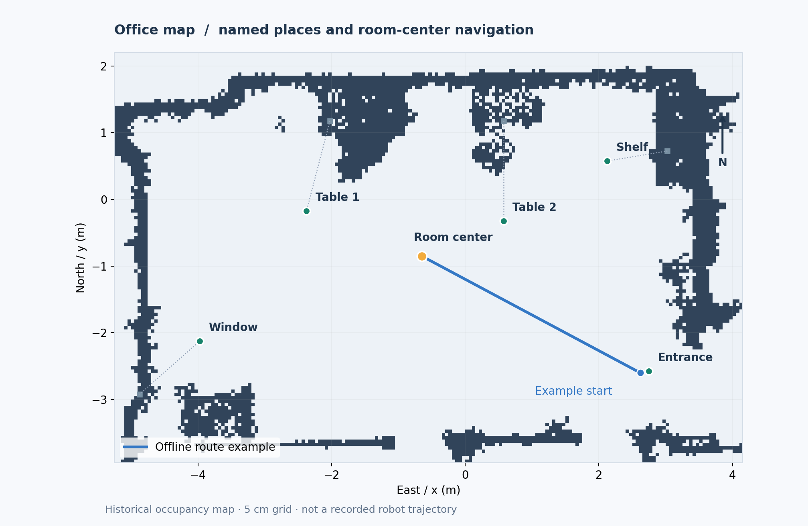
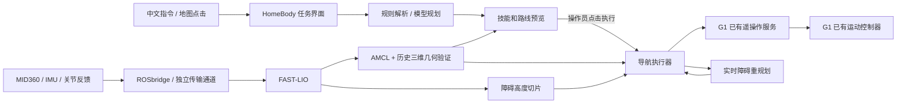

# HomeBody G1 Office

**用中文指令和地图点击，完成宇树 G1 的办公室导航。**

基于 [Stanford HomeBody](https://github.com/Stanford-TML/homebody) 的办公室扩展，将自然语言任务、历史点云定位、路径规划、动态障碍处理和真机执行接在同一个可视化界面中。仓库包含当前有效源码、办公室地图、仿真场景、测试，以及可配置的部署入口。

[快速开始](#快速开始) · [系统架构](#系统架构) · [支持的任务](#支持的任务) · [部署指南](docs/DEPLOYMENT.zh.md) · [验证与限制](docs/VALIDATION.zh.md)



*随仓库提供的真实办公室导航图。蓝线为离线计算的中央目标示例路线，并非一次真机运行轨迹。*

## 项目能力

| 模块 | 实现 |
|---|---|
| 中文任务 | 常见单步指令直接解析，复杂组合由兼容 OpenAI 格式的模型接口生成技能序列 |
| 可视化 | HomeBody 任务界面、地图点击选点、路线和转向预览、独立只读点云查看器 |
| 定位 | MID360 点云与 IMU → FAST-LIO → 官方 ROS 2 `nav2_amcl`，结合历史三维点云核验与自动初始化 |
| 导航 | 静态栅格 A*、目标停车位置搜索、面向路线行走、转向反馈和受限的定位恢复 |
| 实时障碍 | 离地 **0.15–1.80 m** 切片、机身近点过滤、动态障碍层和遇障重规划 |
| 真机接口 | 通过已有认证遥操作服务发送速度；运动请求不自动重放，停止、会话和数据新鲜度检查持续生效 |
| 官方手势 | 挥手、招手与握手适配；静止、控制状态和独占条件满足后执行 |
| 仿真 | 复用 HomeBody / MuJoCo，在办公室占据图生成的代理场景中查看与运行技能 |

这是基于现有 G1 运动控制器的上层系统。导航规划使用本仓库实现；`nav2_amcl` 提供定位，**没有声称部署了整套 Nav2 导航栈，也没有训练新的步态策略**。

## 系统架构



Windows 本机可承担 SSH 转发与浏览器入口，Linux 工作站负责服务和计算，机器人负责传感器与运动。机器人与本机可使用 Wi-Fi；网线不是软件架构的必需条件。详情见 [数据流与坐标系](docs/ARCHITECTURE.zh.md)。

## 支持的任务

| 输入示例 | 生成的行为 |
|---|---|
| `去房间的正中央` / `前往办公室中心` | 导航到主长方形办公室中央 |
| `去桌子一旁边` / `去桌子二` | 导航到对应物体的可接近位置 |
| `去门口` / `去窗口` / `去架子` | 导航到命名地点，必要时调整停车点 |
| `去东北` / `去西南` | 识别隐藏的方位目标；界面不需要显示八个方位标记 |
| `往北走两秒` | 先面向地图北方，再按计划正面行走 |
| `向左走两秒` | 相对机身的左侧平移 |
| `原地左转90度` / `转向东` | 相对角度转身 / 转向地图绝对朝向 |
| `先去桌子1，挥手，再去门口` | 按顺序生成组合任务，执行前预览 |
| 在地图上点击空地 | 预览从当前定位出发的路线 |

地图以 **上北、下南、左西、右东** 定义方位。当前真机计划行走速度为 **0.35 m/s**，转身角速度上限为 **0.45 rad/s**；它们是当前项目参数，不是所有 G1 固件的通用推荐值。

## 快速开始

### 1. 获取代码并运行离线检查

下列命令只检查代码与地图，不连接机器人。

```bash
git clone https://github.com/dk2472780158-ctrl/homebody-g1-office.git
cd homebody-g1-office
python3 -m venv .venv
source .venv/bin/activate
python -m pip install --upgrade pip
python -m pip install numpy scipy pillow websocket-client cbor2 fastapi httpx matplotlib
python -B scripts/check-release.py
python -B scripts/test-office.py
```

Python **3.11+**。离线检查可与真机环境分开安装；不需要机器人、GPU、ROS 或模型密钥。发布附带完整 HomeBody 源码和所用机器人资源，运行原框架的完整仿真另需安装其依赖。

### 2. 安装界面与仿真依赖

建议在 Ubuntu **22.04** 工作站使用独立环境。运行界面会加载 HomeBody / MuJoCo；无显示器环境使用 EGL。

```bash
python -m pip install -e '.[office,dev]'
cp config/local.env.example config/local.env
# 编辑 config/local.env：主机、API 服务、密钥文件位置。
source config/env.sh
python -B scripts/prepare-office.py --publish-localization
```

`prepare-office.py` 只复制 AMCL 所需地图与几何模块，不启动服务、不执行动作。实际密钥保存在仓库外，`config/local.env` 不进入 Git。

### 3. 接通传感器、定位与页面

按 [部署指南](docs/DEPLOYMENT.zh.md) 建立控制、点云、反馈和页面通道，构建并启动隔离传感器容器，然后运行：

```bash
source config/env.sh
bash office/start-g1-readonly-viewer.sh
bash office/start-office-agent.sh
```

打开工作站回环页面，或通过 SSH 转发在本机打开：

| 地址 | 功能 |
|---|---|
| `http://127.0.0.1:8092/` | HomeBody 任务、路线预览和人工执行 |
| `http://127.0.0.1:8093/` | 点云、位置、朝向与地图，只读查看 |

任务流程是：**定位有效 → 生成预览 → 核对目标与路线 → 手动执行 → 查看反馈**。启动页面或提交文本不会自动执行真机移动；使能腿控制和执行任务各有明确入口。

## 仓库结构

```text
.
├── office/                  办公室扩展、地图、技能与测试
│   ├── office_real_workflow.py   中文任务、预览和界面状态
│   ├── g1_real_control.py        闭环执行、停止与恢复
│   ├── g1_dynamic_navigation.py  实时障碍层与重规划
│   ├── g1_readonly_geometry.py   底座运动学与静态规划
│   ├── sensors/             ROSbridge、FAST-LIO、传感器监督
│   │   ├── amcl/            AMCL 文件适配与三维验证
│   │   └── src/             ROS 2 包及其源码
│   ├── robot/               手势适配及遥操作接口参考
│   ├── windows/             可配置的独立 SSH 通道
│   └── office-map-proxy-scene/   MuJoCo 代理场景
├── src/homebody/             上游 HomeBody 与本项目适配
├── assets/                  上游机器人模型、标定及仿真资源
├── config/                  统一环境配置与本地配置模板
├── deploy/                  传感器容器定义
├── scripts/                 离线检查、准备与测试入口
├── docs/                    架构、部署、地图和验证说明
└── tests/                   上游框架测试
```

完整模块导读见 [架构文档](docs/ARCHITECTURE.zh.md)。地图格式、命名点和更新方法见 [地图说明](docs/MAPS.zh.md)。

## 验证状态与边界

- 已有现场人工验证的遥控器行走、网页速度对照行走，以及多轮导航调试。
- 自动测试覆盖解析、地图净空、停车与再次出发、转向反馈、传输异常、定位恢复和手势互斥；使用模拟接口，不驱动物理机器人。
- 最新“房间中央”目标已通过解析与路线预览检查；这不等于已完成该目标的现场到达验收。
- 连续定位观察仍见短暂验证波动；网络失联、会话变化和无法消除的定位歧义会使导航等待或停止。
- `office/robot/teleop_app.reference.py` 是接口集成参考，不是此次已核对最新运行版本的机器人端固件，也不是通用机器人安装器。
- 雷达到底座位置使用原厂模型和在线腰部运动学，仍需按实际硬件核对安装及标定。

详见 [验证记录与已知限制](docs/VALIDATION.zh.md)。仓库不提供“永久不断定位”或所有障碍场景都能通行的保证。

## 来源与许可

HomeBody 基线来自 `Stanford-TML/homebody` 的 `2388aa44…`，保留 [Apache-2.0 LICENSE](LICENSE)、[NOTICE](NOTICE) 与 [第三方声明](THIRD_PARTY_NOTICES.md)。FAST-LIO 等 ROS 包保留各自许可，**不能将整个仓库的所有内容一概视为 Apache-2.0**。

参考项目：[git_slam](https://gitea.databall.tech/databall-official/git_slam) · [g1_nav2](https://gitea.databall.tech/databall-official/g1_nav2) · [Unitree SDK2 Python](https://github.com/unitreerobotics/unitree_sdk2_python) · [Nav2](https://github.com/ros-navigation/navigation2)。

版本、修改范围与来源见 [来源清单](docs/SOURCE_PROVENANCE.json) 和 [依赖与许可说明](docs/DEPENDENCIES.zh.md)。

提交问题时，请附上运行环境、复现指令、任务阶段和去除密钥的错误信息。涉及真机反馈，请注明是现场结果、离线测试还是路线预览。
